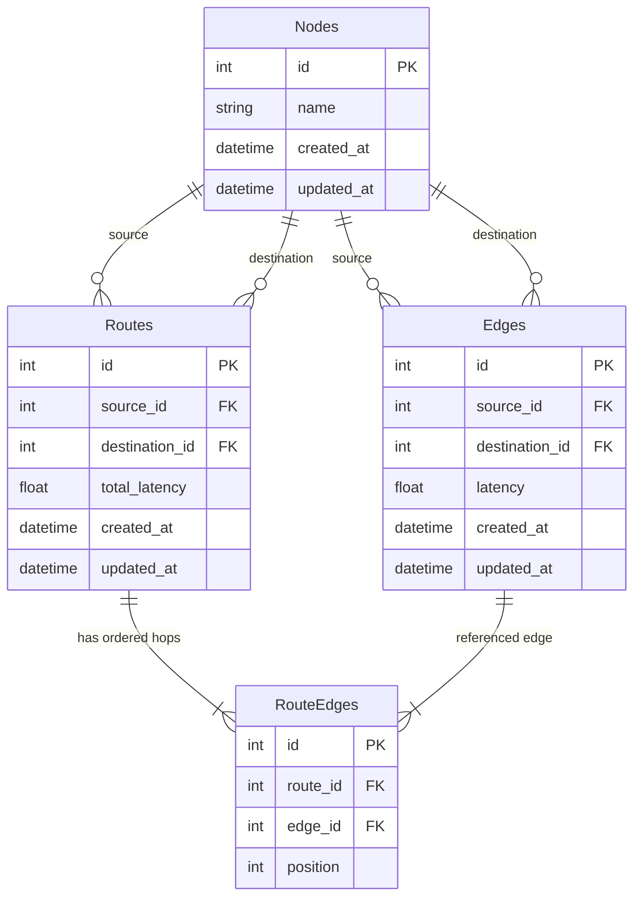

# Network Route Optimization API

A high-performance Django REST Framework API for modeling network graphs, calculating optimal routing paths with minimal latency using Dijkstra's algorithm, and tracking historical route computations.

---

## Table of Contents

- [Key Features](#key-features)
- [Tech Stack](#tech-stack)
- [Project Architecture & Directory Structure](#project-architecture--directory-structure)
- [Database Models & Schema](#database-models--schema)
- [Routing Algorithm](#routing-algorithm)
- [Authentication](#authentication)
- [API Reference](#api-reference)
  - [Nodes API](#nodes-api)
  - [Edges API](#edges-api)
  - [Routes API](#routes-api)
- [Getting Started & Local Setup](#getting-started--local-setup)
- [Example End-to-End Walkthrough](#example-end-to-end-walkthrough)
- [Engineering Highlights & Design Decisions](#engineering-highlights--design-decisions)

---

## Key Features

- **Dynamic Graph Topology**: Create, list, and delete nodes (servers, routers, data centers) and directed edges weighted by latency in milliseconds.
- **Shortest Path Optimization**: Dijkstra's algorithm computes the lowest-latency path between any two nodes.
- **Route History**: Computed routes are stored and can be queried by source, destination, date range, and result limit.
- **Name Normalization**: Node names are matched case-insensitively and trimmed, so `"Server A"` and `"  server a  "` resolve to the same node.
- **Audit Tracking**: All models track `created_by`, `updated_by`, `created_at`, and `updated_at`.

---

## Tech Stack

- **Language**: Python 3.10+ (tested on Python 3.14)
- **Framework**: Django 6.1.2
- **REST API**: Django REST Framework (DRF) 3.18.3
- **Database**: SQLite (default, easily switchable to PostgreSQL/MySQL)
- **Algorithm**: Dijkstra's Algorithm (Min-Heap / `heapq`)

---

## Project Architecture & Directory Structure

```text
Leegality/
├── manage.py                   # Django management script
├── requirements.txt            # Project dependencies
├── db.sqlite3                  # Local SQLite database
├── leegality/                  # Project configuration
│   ├── __init__.py
│   ├── asgi.py                 # ASGI entry point
│   ├── settings.py             # Django settings
│   ├── urls.py                 # Root URL configuration
│   └── wsgi.py                 # WSGI entry point
└── network/                    # Core network application
    ├── admin.py                # Django admin registration
    ├── apps.py                 # App configuration
    ├── models.py               # ORM models (Nodes, Edges, Routes, RouteEdges)
    ├── tests.py                # Test cases
    ├── urls.py                 # Network API route definitions
    ├── views.py
    ├── migrations/             # Database migrations
    └── apis/                   # Modular API endpoints & business logic
        ├── __init__.py
        ├── nodes.py            # Node CRUD endpoints
        ├── edges.py            # Edge CRUD endpoints
        ├── routes.py           # Dijkstra calculation & history endpoints
        └── utils.py            # Normalization and lookup utilities
```

---

## Database Models & Schema

The data model captures network topology and computed routes:



### Model Summary

1. **`GenericModel` (Abstract)**
   - Common audit fields: `created_by`, `updated_by`, `created_at`, `updated_at`.
2. **`Nodes`**
   - Represents a network vertex (e.g., `Server A`, `Server B`).
3. **`Edges`**
   - Represents a directed connection between `source` and `destination` with a `latency` weight.
4. **`Routes`**
   - Stores computed shortest paths between `source` and `destination` along with `total_latency`.
5. **`RouteEdges`**
   - Intermediary model mapping a `Routes` record to an ordered sequence of `Edges` via an explicit `position` index (enforced with a unique constraint on `['route', 'position']`).

---

## Routing Algorithm

The shortest route computation utilizes **Dijkstra's Algorithm** with a priority queue (min-heap):
- **Graph Representation**: Built in-memory as an adjacency list from active `Edges` (`graph[source_id] -> [Edges]`).
- **Time Complexity**: $\mathcal{O}((V + E) \log V)$ where $V$ is the number of nodes and $E$ is the number of edges.
- **Path Reconstruction**: Backtracks through `previous_edge` pointers starting from `destination_id` to build the exact sequence of hops.
- **Smart Route Persistence**: When a path is found, the system checks whether a route record exists for that pair. If no route exists, or if the newly computed path has a strictly lower total latency than previously recorded, the new optimal route and its ordered hops are saved atomically.

---

## Authentication

All API endpoints are protected with `permissions.IsAuthenticated`.
- Supports standard **Basic Authentication** (passing HTTP header `Authorization: Basic <credentials>`) and **Session Authentication**.
- When testing via `curl`, use the `-u username:password` option.

---

## API Reference

### Summary of Endpoints

| Method | Endpoint | Description |
|---|---|---|
| `GET` | `/nodes/` | List all nodes |
| `POST` | `/nodes/` | Create a new node |
| `DELETE` | `/nodes/<id>/` | Delete a node by ID |
| `GET` | `/edges/` | List all edges |
| `POST` | `/edges/` | Create a directed edge |
| `DELETE` | `/edges/<id>/` | Delete an edge by ID |
| `POST` | `/routes/shortest/` | Calculate optimal path using Dijkstra |
| `GET` | `/routes/history/` | Query historical route calculations |

---

### Nodes API

#### 1. List Nodes
- **URL**: `GET /nodes/`
- **Response** `200 OK`:
  ```json
  [
    {
      "id": 1,
      "name": "Server A"
    },
    {
      "id": 2,
      "name": "Server B"
    }
  ]
  ```

#### 2. Create Node
- **URL**: `POST /nodes/`
- **Request Body**:
  ```json
  {
    "name": "Server C"
  }
  ```
- **Validation**:
  - `name` cannot be empty.
  - Duplicate names (evaluated case-insensitively with leading/trailing whitespace trimmed) return `400 Bad Request`.
- **Response** `201 Created`:
  ```json
  {
    "id": 3,
    "name": "Server C"
  }
  ```

#### 3. Delete Node
- **URL**: `DELETE /nodes/<node_id>/`
- **Response** `200 OK`:
  ```json
  {
    "message": "Node deleted successfully"
  }
  ```
- **Response** `404 Not Found`:
  ```json
  {
    "error": "Node not found"
  }
  ```

---

### Edges API

#### 1. List Edges
- **URL**: `GET /edges/`
- **Response** `200 OK`:
  ```json
  [
    {
      "id": 1,
      "source": "Server A",
      "destination": "Server B",
      "latency": 30.0
    }
  ]
  ```

#### 2. Create Edge
- **URL**: `POST /edges/`
- **Request Body**:
  ```json
  {
    "source": "Server A",
    "destination": "Server C",
    "latency": 10.0
  }
  ```
- **Validation Rules**:
  - `latency` must be a non-negative number.
  - `source` and `destination` must be provided and cannot refer to the same node.
  - Source and destination nodes must exist (returns `404 Not Found` if missing).
  - Duplicate directed edge between the same source and destination returns `400 Bad Request`.
- **Response** `201 Created`:
  ```json
  {
    "id": 2,
    "source": "Server A",
    "destination": "Server C",
    "latency": 10.0
  }
  ```

#### 3. Delete Edge
- **URL**: `DELETE /edges/<edge_id>/`
- **Response** `200 OK`:
  ```json
  {
    "message": "Edge deleted successfully"
  }
  ```

---

### Routes API

#### 1. Find Shortest Route
- **URL**: `POST /routes/shortest/`
- **Request Body**:
  ```json
  {
    "source": "Server A",
    "destination": "Server B"
  }
  ```
- **Response** `200 OK`:
  ```json
  {
    "total_latency": 12.0,
    "path": [
      "Server A",
      "Server C",
      "Server D",
      "Server B"
    ]
  }
  ```
- **Error Responses**:
  - `400 Bad Request`: Missing parameters or source matches destination.
  - `404 Not Found`: Source/destination node does not exist or no path connects them.

#### 2. Route History & Filtering
- **URL**: `GET /routes/history/`
- **Query Parameters**:
  - `source` *(optional)*: Filter by source node name (case-insensitive).
  - `destination` *(optional)*: Filter by destination node name (case-insensitive).
  - `date_from` *(optional)*: Filter routes created on or after date (`YYYY-MM-DD`).
  - `date_to` *(optional)*: Filter routes created on or before date (`YYYY-MM-DD`).
  - `limit` *(optional)*: Maximum number of records to return (positive integer).
- **Example Request**:
  ```text
  GET /routes/history/?source=Server%20A&destination=Server%20B&limit=5
  ```
- **Response** `200 OK`:
  ```json
  [
    {
      "id": 2,
      "source": "Server A",
      "destination": "Server B",
      "total_latency": 12.0,
      "path": [
        "Server A",
        "Server C",
        "Server D",
        "Server B"
      ],
      "created_at": "2026-10-25T07:30:15.123456Z"
    },
    {
      "id": 1,
      "source": "Server A",
      "destination": "Server B",
      "total_latency": 15.0,
      "path": [
        "Server A",
        "Server C",
        "Server B"
      ],
      "created_at": "2026-10-25T07:28:10.654321Z"
    }
  ]
  ```

---

## Getting Started & Local Setup

### 1. Prerequisites
- Python 3.10 or higher
- `pip` and virtual environment support

### 2. Clone and Setup Environment

```bash
# Clone the repository
git clone <repository_url>
cd Leegality

# Create a virtual environment
python3 -m venv venv

# Activate virtual environment
# On macOS/Linux:
source venv/bin/activate
# On Windows:
# venv\Scripts\activate

# Install required dependencies
pip install -r requirements.txt
```

### 3. Run Migrations

```bash
python manage.py migrate
```

### 4. Create an Admin / API User

Because all endpoints require authentication, create a user:

```bash
python manage.py createsuperuser
```
Follow the interactive prompts to set a username and password.

### 5. Start Development Server

```bash
python manage.py runserver
```
The server will start at `http://127.0.0.1:8000/`.

---

## Example End-to-End Walkthrough

Here is a complete scenario testing the API using `curl` with user credentials `admin:password`:

```bash
# 1. Create Nodes
curl -u admin:password -X POST http://127.0.0.1:8000/nodes/ \
  -H "Content-Type: application/json" \
  -d '{"name": "Server A"}'

curl -u admin:password -X POST http://127.0.0.1:8000/nodes/ \
  -H "Content-Type: application/json" \
  -d '{"name": "Server B"}'

curl -u admin:password -X POST http://127.0.0.1:8000/nodes/ \
  -H "Content-Type: application/json" \
  -d '{"name": "Server C"}'

# 2. Create Directed Edges with Latencies
# Direct edge: A -> B with latency 30
curl -u admin:password -X POST http://127.0.0.1:8000/edges/ \
  -H "Content-Type: application/json" \
  -d '{"source": "Server A", "destination": "Server B", "latency": 30.0}'

# Alternate route: A -> C (10) and C -> B (5) -> Total latency: 15
curl -u admin:password -X POST http://127.0.0.1:8000/edges/ \
  -H "Content-Type: application/json" \
  -d '{"source": "Server A", "destination": "Server C", "latency": 10.0}'

curl -u admin:password -X POST http://127.0.0.1:8000/edges/ \
  -H "Content-Type: application/json" \
  -d '{"source": "Server C", "destination": "Server B", "latency": 5.0}'

# 3. Find Shortest Path between Server A and Server B
curl -u admin:password -X POST http://127.0.0.1:8000/routes/shortest/ \
  -H "Content-Type: application/json" \
  -d '{"source": "Server A", "destination": "Server B"}'

# Output:
# {"total_latency": 15.0, "path": ["Server A", "Server C", "Server B"]}

# 4. View Route History
curl -u admin:password -X GET "http://127.0.0.1:8000/routes/history/?source=Server%20A"
```

---

## Engineering Highlights & Design Decisions

1. **Normalized Lookups**:
   - `Lower(Trim('name'))` annotations eliminate subtle casing and whitespace mismatches across inputs and database records.
2. **Transaction Safety**:
   - Database modifications (such as route generation and multi-hop `RouteEdges` association) are enclosed in `transaction.atomic()` to prevent orphaned or partial records.
3. **Query Optimization**:
   - `ShortestRouteView` fetches all edges in a single query using `select_related('source', 'destination')` to construct the graph in memory.
   - `RouteHistoryView` uses `Prefetch` with `select_related('edge__destination')` to serialize multi-hop paths without redundant database queries.
4. **Relational Path Preservation**:
   - Instead of storing raw strings or unstructured JSON, routes maintain referential integrity via a dedicated `RouteEdges` intermediate table with positional ordering.
